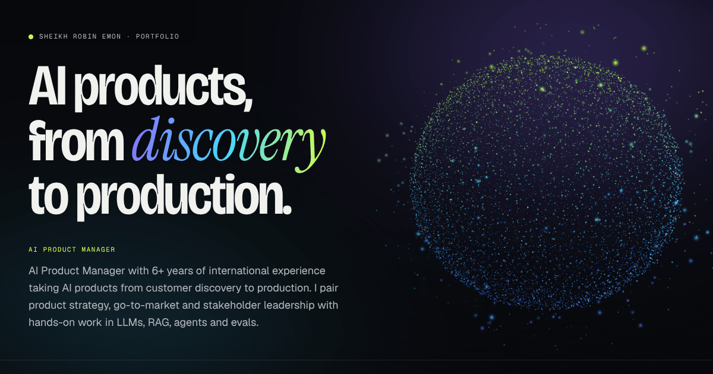

# Sheikh Robin Emon · Portfolio

**Live site: https://sheikhrobinemon-usf.github.io/Portfolio/**

Personal portfolio for Sheikh Robin Emon, AI Product Manager and Forward Deployed AI Engineer.

Plain HTML, CSS and JavaScript. No framework, no npm, no build step, no dependencies. Fonts and
images are in the repository, so the site works offline.



## View it

- **Online:** https://sheikhrobinemon-usf.github.io/Portfolio/
- **On your computer:** download or clone the repository and double-click `index.html`.

## What is in it

- **Scroll-driven 3D backdrop.** A WebGL particle field, written directly against the browser's
  WebGL API, that morphs between five shapes as you scroll: sphere, wave, knot, helix and halo.
- **Kinetic type.** The hero and contact headlines use Bricolage Grotesque's weight and width
  axes. Letters thicken and widen near the cursor; on touch screens a slow wave rolls through.
- **"Read this site as."** Switch between AI Product Manager, Forward Deployed AI Engineer and
  Business Analyst. Summaries, metrics, experience bullets, skills and case studies reorder for
  that reader.
- **Portfolio assistant.** Ask questions about the work. It searches this site's own content
  (BM25 plus an intent router), cites its sources, and can scroll to sections, open case studies,
  switch the theme and change the lens. It runs in the browser: no API keys, no network calls.
  It also takes voice input where the browser supports it.
- **Command palette.** Press `⌘K` / `Ctrl K` to jump anywhere or hand a question to the assistant.
  `⌘J` / `Ctrl J` opens the assistant.
- **Case study gallery.** 23 pieces of shipped work, filterable by category. Each card opens a
  drawer with the overview, what was done, the impact and the tools; arrow keys step through.
- **Case studies** for Hospital Ops Copilot and ModelROI AI, with screenshots and eval tables.
- **Dark and light themes**, with a circular reveal when you switch. Respects
  `prefers-reduced-motion`, works with a keyboard, and lays out for phones.

## Edit the content

Every word on the site lives in **`assets/js/data.js`**. Edit it, save, and refresh the browser.

| Section of `data.js` | Holds |
|---|---|
| `profile` | Name, links, location, summaries for each lens, organizations |
| `metrics` | The headline numbers in the Impact section |
| `experience` | Roles and bullets; each bullet lists the lenses it matters to |
| `caseStudies` | Hospital Ops Copilot and ModelROI AI pages |
| `shipped` | The 23-item case study gallery |
| `technologies`, `capabilities` | The Toolkit section |
| `education`, `awards`, `story`, `strengths` | The About section |

Images go in `assets/img/`. Screenshots for the case studies are in `assets/img/projects/`.

## Files

```
index.html                     home page
work/hospital-ops-copilot.html case study
work/modelroi-ai.html          case study
404.html                       not-found page for GitHub Pages
assets/css/styles.css          all styles and design tokens
assets/js/data.js              all content
assets/js/main.js              rendering, lens switch, theme, scroll effects, drawer, palette
assets/js/field.js             WebGL particle field
assets/js/engine.js            assistant answer engine (search and intent routing)
assets/js/assistant.js         assistant chat panel
assets/fonts/                  Bricolage Grotesque, Geist, Geist Mono, Instrument Serif
assets/img/                    portrait, project screenshots, icon, social preview
```

## Publish changes

The site is served by GitHub Pages from the `main` branch. Commit and push to `main`, and the
live site updates within a minute or two.

## Credits

Fonts are under the SIL Open Font License: Bricolage Grotesque (Mathieu Triay), Geist and
Geist Mono (Vercel), Instrument Serif (Instrument). Icons are paths from Lucide (ISC license).

## License

MIT, see [LICENSE](LICENSE).
