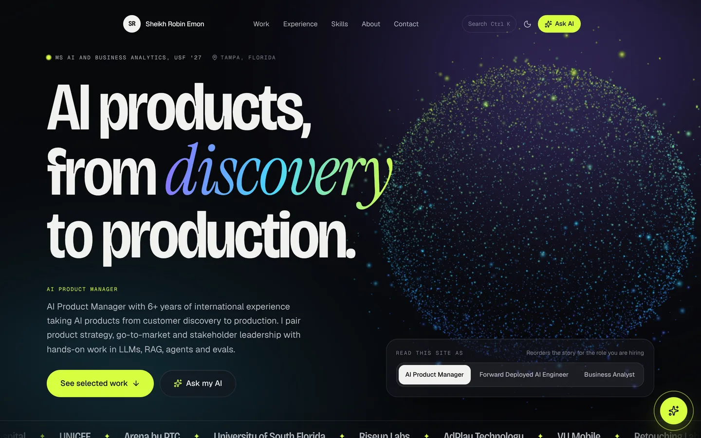
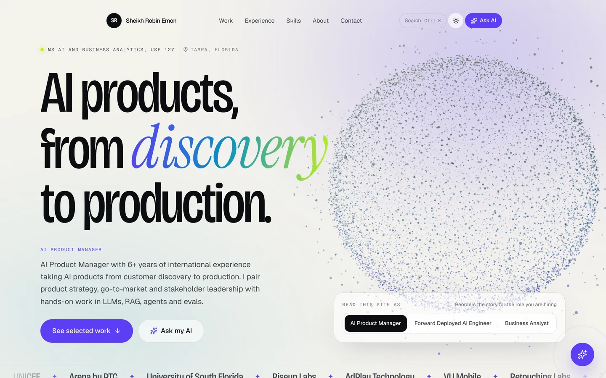
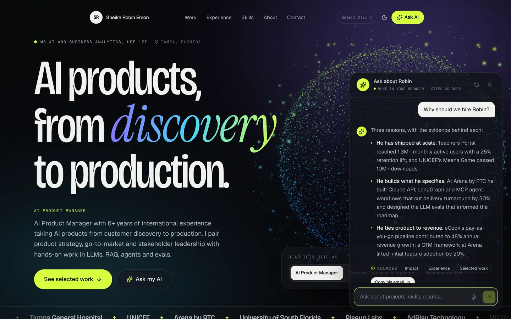

# Sheikh Robin Emon · Portfolio

Personal portfolio for Sheikh Robin Emon, AI Product Manager and Forward Deployed AI Engineer.
A statically exported Next.js site with a scroll-driven WebGL backdrop, variable-font kinetic
type, a command palette, and an assistant that answers questions about the work from the site's
own content.



| Light theme | Portfolio assistant |
|---|---|
|  |  |

## What is in it

- **Scrollytelling backdrop.** One WebGL particle field (Three.js through React Three Fiber) that
  morphs between five shapes as you move through the page: sphere, wave, knot, helix, halo.
- **Kinetic type.** The hero and contact headlines use Bricolage Grotesque's weight and width axes.
  Characters thicken and widen near the cursor; on touch devices a slow wave rolls through instead.
- **Lens switch.** "Read this site as" AI Product Manager, Forward Deployed AI Engineer or Business
  Analyst. Summaries, experience bullets, skills and products reorder for that reader.
- **Portfolio assistant.** A retrieval engine that runs in the browser: a BM25 index over the same
  content files that render the site, plus an intent router. It cites its sources, can scroll to
  sections, open case studies, switch theme and change the lens, and takes voice input where the
  browser supports it. No API keys, no network calls, and it declines questions the site cannot
  answer.
- **Command palette.** `⌘K` / `Ctrl K` to jump anywhere, run actions, or hand a question to the
  assistant. `⌘J` / `Ctrl J` toggles the assistant.
- **Case studies** for Hospital Ops Copilot and ModelROI AI, with shared-element view transitions
  from the home page.
- **Case study gallery.** 22 pieces of shipped work, filterable by category, each opening a
  slide-over with the overview, what was done, the impact and the tools. Arrow keys step through.
- **Dark-mode-first** with a full light theme (circular reveal on switch), `prefers-reduced-motion`
  support throughout, keyboard navigation, and a skip link.

## Stack

| Layer | Choice |
|---|---|
| Framework | Next.js 16 (App Router, static export), React 19 with the React Compiler |
| Language | TypeScript |
| Styling | Tailwind CSS v4, design tokens as CSS variables |
| Motion | Motion, Lenis smooth scrolling, React `<ViewTransition>` |
| 3D | Three.js, React Three Fiber, custom GLSL |
| UI | cmdk, Lucide icons, Fontsource variable fonts |
| Component workshop | Storybook 10 |

## Run it

Requires Node.js 20.9 or newer.

```bash
npm install
```

```bash
npm run dev
```

Open http://localhost:3000.

| Command | What it does |
|---|---|
| `npm run dev` | Development server |
| `npm run build` | Static export to `out/` |
| `npm run lint` | ESLint |
| `npm run typecheck` | Route type generation and `tsc` |
| `npm run storybook` | Storybook on port 6006 |
| `npm run build-storybook` | Static Storybook build |

## Edit the content

All copy lives in `src/content`. The page, the command palette and the assistant's index are all
generated from these files, so a change in one place updates everything.

| File | Holds |
|---|---|
| `profile.ts` | Name, links, summaries per lens, headline metrics, education, awards, story |
| `experience.ts` | Roles and bullets, each tagged with the lenses it matters to |
| `projects.ts` | Open-source case studies, Clearline, and the case study gallery |
| `skills.ts` | Capabilities and technologies |

To add a case study, add an entry to `caseStudies` in `projects.ts` and put its screenshots in
`src/assets/projects`. The route `/work/<slug>` is generated at build time.

## Project structure

```
src/
  app/                 routes, layout, global styles, sitemap and robots
  assets/              portrait and project screenshots
  content/             all site copy as typed data
  components/
    canvas/            WebGL particle field and its shapes
    sections/          hero, impact, work, gallery and its drawer, experience, skills, about, contact
    assistant/         assistant panel
    command/           command palette
    layout/            nav, footer, scroll progress
    providers/         theme, lens, smooth scroll and overlay state
    ui/                buttons, chips, counters, kinetic type and other primitives
  lib/
    assistant/         knowledge builder and retrieval engine
.storybook/            Storybook config
.github/workflows/     CI and GitHub Pages deployment
```

## Deploy

The site is a static export, so any static host works.

**GitHub Pages.** In the repository, open Settings, then Pages, and set the source to
"GitHub Actions". Every push to `main` then runs `.github/workflows/deploy.yml`, which builds with
the right base path and publishes `out/`.

**Vercel, Netlify or Cloudflare Pages.** Import the repository. The build command is
`npm run build` and the output directory is `out`. No environment variables are needed at the
domain root.

| Variable | Purpose | Default |
|---|---|---|
| `NEXT_PUBLIC_BASE_PATH` | Sub-path the site is served from, for example `/Portfolio` | empty |
| `NEXT_PUBLIC_SITE_URL` | Canonical URL, used for the sitemap and social cards | GitHub Pages URL |

## License

MIT, see [LICENSE](LICENSE).
